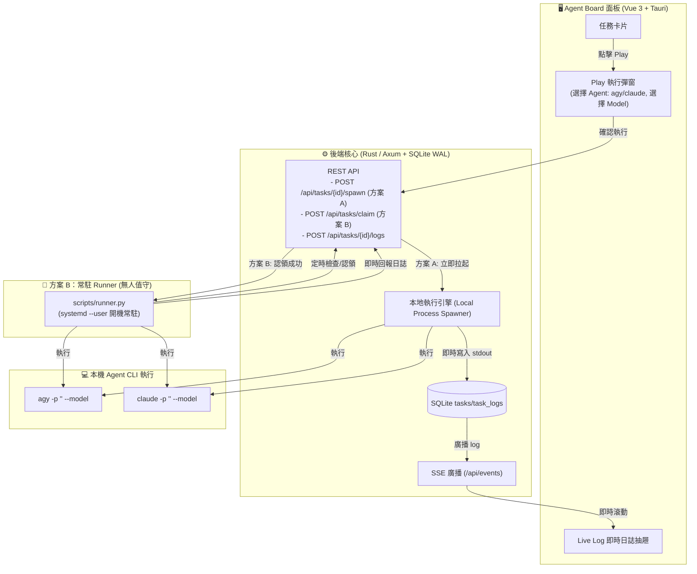

# 📋 Agent Board: A + B 雙軌執行架構規劃書 (Hybrid Execution Plan)

## 🎯 目標與背景
使用者需要能靈活驅動 **`agy`** 與 **`claude`** 執行任務，並具備自訂模型的彈性：
1. **方案 A (Direct Spawn)**：使用者在 Web/桌面面板上看到任務卡片，點擊 **「▶ Play」** 時可選擇 Agent 與模型，由面板後端直接拉起本機 Process 執行，日誌即時推播，所見即所得。
2. **方案 B (Autonomous Runner)**：無人值守場景（如 Claude 批量產生 10 個任務或開機背景服務），由輕量 Runner 自動輪詢領取任務並執行，零手動干預。

雙軌架構彼此共用相同的資料庫狀態機、即時日誌流與完成回報端點，互不衝突。

---

## 🏗️ 核心架構設計

### 1. 雙軌架構全景圖

---

## 🛠️ 詳細規格設計

### 1. 資料模型擴充 (`tasks` 資料表)
在 `tasks` 表增加模型欄位以持久化執行偏好：
* `model TEXT`：指定使用的模型名稱（例如：`gemini-3.8-flash-low`、`claude-sonnet-5-5-medium`、`claude-3-5-sonnet`）。若為 `NULL` 則使用 Agent 預設模型。

### 2. 支援的 Agent CLI 指令映射

| Agent | 執行指令模板 | 說明 |
| :--- | :--- | :--- |
| **agy** | `agy -p "<prompt>" --model <model>` | 以非互動 print 模式執行單次 prompt，可選附帶 `--dangerously-skip-permissions` |
| **claude** | `claude -p "<prompt>" --model <model>` | 以 non-interactive print 模式執行 prompt |

#### 常用模型選項 (Model Presets)
* **agy (Gemini / Claude / OSS 系列)**：
  * `gemini-3.8-flash-low`（預設，輕量快速）
  * `gemini-4-argon-medium`
  * `claude-sonnet-5-5-medium`
  * `claude-opus-5-5-high`
* **claude (Anthropic 系列)**：
  * `claude-3-7-sonnet`（預設推薦）
  * `claude-3-5-sonnet`
  * `claude-3-5-haiku`

---

## 📐 實作分工與時序

### 方案 A：面板直接 Spawn Process 流程
1. 使用者在面板點擊卡片上的 **「▶ Play」**。
2. 彈出 **「執行任務 (Run Task)」** 對話框：
   * 選擇 Target Agent（預設讀取任務被指派者，可手動切換 `agy` 或 `claude`）。
   * 選擇 Model（下拉選單提供 Preset，亦可自行輸入）。
3. 面板發送 `POST /api/tasks/{id}/spawn`：
   * Payload: `{ "agent_id": "agy", "model": "gemini-3.8-flash-low" }`
4. 後端 Rust 核心：
   * 將任務狀態更新為 `running`，記錄 `assigned_agent` 與 `model`。
   * 以 `tokio::process::Command` 非同步啟動子進程。
   * 透過管線逐行讀取 stdout/stderr，寫入 `task_logs` 表並透過 SSE 廣播。
   * 進程退出碼為 0 則標為 `completed`，非 0 標為 `failed`。

### 方案 B：外部 Runner 增強支援
1. 更新 [`scripts/runner.py`](file:///home/naxo/private/agent_board/scripts/runner.py)：
   * 領取任務（`claim_task`）時解析回傳的 `assigned_agent` 與 `model`。
   * 若任務有指定 `model`，自動加上 `--model <model>` 參數。
   * 依據 `assigned_agent` 自動分支執行 `agy` 或 `claude` CLI。
   * 保持原有背景發送心跳與日誌串流至看板。

---

## 📅 實施步驟 (Action Items)

- [ ] **Step 1 (DB 遷移)**：在 `tasks` 表增加 `model` 欄位。
- [ ] **Step 2 (後端 Spawner)**：在 Rust 後端新增 `POST /api/tasks/{id}/spawn` 端點與子程序管理模組。
- [ ] **Step 3 (前端 Play 彈窗)**：實作「執行設定彈窗（Play Modal）」，提供 Agent 與 Model 快速選擇。
- [ ] **Step 4 (Runner 增強)**：更新 `runner.py` 支援 `claude` 與 `--model` 參數解析。
- [ ] **Step 5 (整合測試)**：驗證手動 Play 與常駐 Runner 兩種模式調用 `agy` / `claude` 順利產出日誌。
