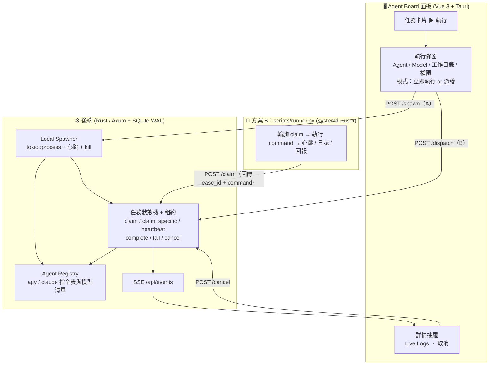

# 📋 Agent Board: A + B 雙軌執行架構規劃書 (Hybrid Execution Plan)

## 🎯 目標與背景
使用者需要能靈活驅動 **`agy`** 與 **`claude`** 執行任務，並可逐任務指定模型：
1. **方案 A (Direct Spawn)**：在面板點擊任務卡片的 **「▶ 執行」**，選擇 Agent 與模型後，由面板後端直接拉起本機 Process 執行，日誌即時推播，所見即所得。
2. **方案 B (Autonomous Runner)**：無人值守場景（如 Claude 批量產生 10 個任務、開機背景服務），由輕量 Runner 輪詢領取並執行，零手動干預。

兩軌共用**同一套狀態機與租約（lease）**、同一份 Agent 指令表、同一條日誌流，彼此不會搶到同一個任務。

---

## ✨ 相較初版的調整（優化重點）

| # | 初版設計 | 調整後 | 原因 |
|---|---|---|---|
| 1 | Spawner 直接把任務設成 `running` | Spawner 透過 `claim_specific` 取得**租約**，執行期間自己送心跳 | 與 Runner 共用原子領取，不會雙重執行；App 關閉時子程序跟著結束，租約逾時後自動重試（最多 3 次） |
| 2 | 指令模板在 Rust 與 `runner.py` 各寫一份 | 只在後端的 **Agent Registry** 定義；`claim` 回傳組好的 `command`（argv） | 兩邊永遠一致；新增 Agent 只改一處 |
| 3 | `agy -p "<prompt>" --model <model>` | 參數放前面、prompt 放最後，`-p` 必帶；不經過 shell；stdin 關閉 | agy 用 Go flag 解析，遇到第一個非 flag 參數就停止，放在 prompt 之後的 flag 會被忽略；舊 Runner 少了 `-p` 會進入互動模式卡住；不經 shell，prompt 內容就不會被當成指令執行 |
| 4 | 權限未定義 | 預設只自動核准**檔案編輯**；要給「完整權限」得逐任務勾選 | 非互動模式下沒有人能回答權限詢問；完整權限等於讓任務內容任意執行指令，不能是預設值 |
| 5 | 無法中止 | 新增 `POST /api/tasks/{id}/cancel` | 方案 A：直接 kill 子程序；方案 B：租約作廢，Runner 下次心跳收到 409 後自行中止 agy |
| 6 | 未定義工作目錄 | 任務新增 `workdir` | Tauri App 的 cwd 不固定，Agent 需要知道要在哪個專案裡工作 |
| 7 | 模型清單為假設值 | 改為 CLI 實際支援的值（`agy models` 輸出與 claude 的模型別名） | `claude-3-7-sonnet` 等名稱已過時 |
| 8 | Play 只做方案 A | 執行彈窗提供兩種模式：**立即在本機執行**（A）或 **派發給 Runner**（B） | 同一個入口，使用者依情境選擇 |

---

## 🏗️ 架構

---

## 🛠️ 詳細規格

### 1. 資料模型（`tasks` 新增欄位，啟動時自動遷移）
| 欄位 | 型別 | 說明 |
|---|---|---|
| `model` | `TEXT NULL` | 指定模型；`NULL` 代表使用 Agent 預設 |
| `workdir` | `TEXT NULL` | 執行時的工作目錄；`NULL` 代表 Runner 的 cwd，方案 A 則為 `AGENT_BOARD_WORKDIR` 或家目錄 |
| `auto_approve` | `INTEGER NOT NULL DEFAULT 0` | `1` = 完整權限（略過所有權限詢問） |

### 2. Agent 指令映射（Agent Registry）

| Agent | argv（prompt 永遠在最後） |
|---|---|
| **agy** | `agy [--model M] (--mode accept-edits \| --dangerously-skip-permissions) -p <prompt>` |
| **claude** | `claude [--model M] --permission-mode (acceptEdits \| bypassPermissions) -p <prompt>` |

括號內前者為預設，後者為勾選「完整權限」時使用。

**模型預設清單**（下拉選單可自行輸入其他值）：
* **agy**（`agy models`）：`gemini-3.8-flash-low`（預設）、`gemini-3.8-flash-medium`、`gemini-4-argon-medium`、`gemini-4-argon-high`、`claude-sonnet-5-5-medium`、`claude-opus-5-5-high`、`gpt-oss-120b-medium`
* **claude**（模型別名或完整名稱）：`sonnet`（預設）、`opus`、`haiku`、`fable`

### 3. API

| 端點 | Body | 說明 |
|---|---|---|
| `GET /api/agents` | — | Agent 清單與模型預設值（前端下拉選單用） |
| `POST /api/tasks/{id}/spawn` | `{ agent_id, model?, workdir?, auto_approve? }` | **方案 A**：儲存執行設定 → `claim_specific` → 拉起子程序 |
| `POST /api/tasks/{id}/dispatch` | 同上（`agent_id` 可省略） | **方案 B**：儲存執行設定並排到該 Agent 佇列最前面 |
| `POST /api/tasks/claim` | `{ agent_id }` | 回傳任務 + `lease_id` + `command`（argv；不支援的 Agent 為 `null`） |
| `POST /api/tasks/{id}/cancel` | — | `queued` / `running` → `failed`，租約作廢、本機子程序 kill，依賴鏈一併失敗 |

`spawn` 在任務不在佇列中、前置任務未完成或 Agent 不支援時回 `409`。

---

## 📐 執行時序

### 方案 A：面板直接 Spawn
1. 使用者點擊卡片 **「▶ 執行」** → 彈出執行彈窗（預設帶入任務目前的 Agent / 模型 / 工作目錄）。
2. 選擇「立即在本機執行」 → `POST /api/tasks/{id}/spawn`。
3. 後端：
   * 寫入執行設定，以 `claim_specific` 原子領取該任務（狀態必須是 `queued`、前置任務必須已完成），取得租約。
   * 依 Registry 組出 argv，以 `tokio::process::Command` 啟動（`stdin` 關閉、`kill_on_drop`）。
   * stdout / stderr 逐行寫入 `task_logs` 並以 SSE 廣播。
   * 每 `LEASE_TIMEOUT_SECS / 3` 秒送一次心跳；心跳被拒（任務被取消或回收）就 kill 子程序。
   * 結束碼 0 → `completed`，非 0 → `failed`；被取消則不覆寫狀態。

### 方案 B：常駐 Runner
1. 使用者選「派發給 Runner」 → `POST /api/tasks/{id}/dispatch`，或任務本來就在佇列中。
2. `runner.py` 輪詢 `claim`，拿到 `lease_id` 與 `command`，在 `workdir`（若有）執行 `command`。
3. 心跳執行緒獨立運作；收到 409（被取消或回收）就中止子程序。
4. 依結束碼回報 `complete` / `fail`。

---

## 📅 實施步驟

- [x] **Step 1 (DB)**：`tasks` 新增 `model`、`workdir`、`auto_approve`。
- [x] **Step 2 (Registry)**：`features/agents`，負責組出 argv 與提供 `GET /api/agents`。
- [x] **Step 3 (Spawner)**：`features/execution`，新增 `spawn` / `cancel` 端點，`claim` 回傳 `command`。
- [x] **Step 4 (前端)**：執行彈窗（兩種模式）、抽屜顯示執行設定與取消按鈕。
- [x] **Step 5 (Runner)**：改用伺服器回傳的 `command`，支援 `workdir`。
- [x] **Step 6 (測試)**：Rust 單元測試（argv、claim_specific、cancel、Spawner 成功 / 失敗 / 取消）；整合測試以 headless 伺服器實際呼叫 `agy` 與 `claude` 跑完兩種模式。

---

## 🔭 暫不納入（之後視需要再做）
* **並行上限**：目前方案 A 每點一次就開一個子程序，大量執行時可能需要每個 Agent 的並行數限制。
* **stream-json 解析**：改用 `--output-format stream-json` 可顯示工具呼叫等結構化進度，但需要前端另做渲染。
* **日誌批次寫入**：Agent 輸出量大時，逐行 INSERT + SSE 可改為每 N 毫秒批次處理。
* **多機 Runner**：目前 API 只監聽 127.0.0.1。
